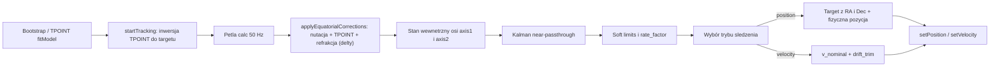

# Analiza mechanizmu śledzenia po kalibracji — stabilność i anomalie

**Data:** 2026-11-15  
**Zakres:** ścieżka śledzenia po kalibracji bootstrap/TPOINT dla EQUATORIAL, ALT_AZ i CASUAL  
**Kod:** [`src/controllers/mount_controller.cpp`](../../src/controllers/mount_controller.cpp) (10 246 linii), [`include/core/mount_kinematics.h`](../../include/core/mount_kinematics.h), [`include/core/mount_coordinates.h`](../../include/core/mount_coordinates.h)  
**Metoda:** analiza przepływu danych, stanu współdzielonego, zabezpieczeń numerycznych i ścieżek komend pozycji/prędkości.

---

## 1. Wniosek w jednym akapicie

Mechanizm śledzenia jest **dobrze zabezpieczony numerycznie i wątkowo** (dziesiątki guardów `isfinite`, watchdog pętli, limity miękkie, wykrywanie desync, brak blokującego I/O pod `state_mutex_`, uporządkowany shutdown), ale ma **jedną istotną wadę architektoniczną**: w domyślnym trybie pozycyjnym **przyrostowe korekcje astronomiczne (nutacja, TPOINT, refrakcja) są liczone i aplikowane do wewnętrznego stanu osi, lecz nie trafiają do komendy pozycji** — target jest rekonstruowany z zapisanych RA/Dec i fizycznej pozycji napędu ([`mount_controller.cpp:3264`](../../src/controllers/mount_controller.cpp:3264), [`3583`](../../src/controllers/mount_controller.cpp:3583)). W efekcie część łańcucha korekcji może być w praktyce „kosmetyczna” (status/internal state), a nie sterująca. Dodatkowo występują punkty nieciągłości: **brak resetu stanu korekcji po meridian flip**, **rekalibracja w trakcie śledzenia**, **nieaktualizowany stan refrakcji przy `refraction <= 0`**, **brak testu zbieżności inwersji TPOINT** oraz **całkowity brak automatycznego odzysku po `ERROR`**. To główne źródła potencjalnych anomalii typu „skok po flipie”, „dryf mimo kalibracji”, „pulsacja” i „zatrzymanie po jednym glitchu”.

---

## 1a. Status wdrożenia poprawek (2026-11-15)

Poniższa tabela podsumowuje, które poprawki zostały zaaplikowane w
[`src/controllers/mount_controller.cpp`](../../src/controllers/mount_controller.cpp):

| Sekcja | Poprawka | Status |
|--------|----------|--------|
| §4.2 | Reset stanu korekcji po meridian flip | ✅ Zastosowano ([`mount_controller.cpp:3041`](../../src/controllers/mount_controller.cpp:3041)) |
| §4.3 | Guard kalibracji podczas śledzenia | ✅ Zastosowano ([`mount_controller.cpp:4956`](../../src/controllers/mount_controller.cpp:4956), [`5408`](../../src/controllers/mount_controller.cpp:5408)) |
| §4.4 | Test zbieżności inwersji TPOINT | ✅ Zastosowano ([`mount_controller.cpp:9111`](../../src/controllers/mount_controller.cpp:9111)) |
| §4.5 | Refrakcja: ciągła aktualizacja stanu, clamp RA, maska + histereza horyzontu | ✅ Zastosowano ([`mount_controller.cpp:8940`](../../src/controllers/mount_controller.cpp:8940)) |
| §4.6 | Usunięcie martwego stanu `drift_expected_*`, pętla względem celu nieba | ✅ Zastosowano |
| §4.8 | `rate_factor` per oś + wygładzanie | ✅ Zastosowano ([`mount_controller.cpp:2346`](../../src/controllers/mount_controller.cpp:2346)) |
| §4.9 | Auto-recovery po błędzie numerycznym (konfigurowalne `tracking_error_retries`, domyślnie 3) | ✅ Zastosowano ([`mount_controller.cpp:2598`](../../src/controllers/mount_controller.cpp:2598)) |
| §4.10 | Próg jakości kalibracji TPOINT | ✅ Zastosowano ([`mount_controller.cpp:5722`](../../src/controllers/mount_controller.cpp:5722)) |
| §4.11A | Spójne ramki nutacja/TPOINT (pre-nutation snapshot HA + Dec) | ✅ Zastosowano ([`mount_controller.cpp:8822`](../../src/controllers/mount_controller.cpp:8822)) |
| §4.11B | Nutacja w Dec | ✅ Zastosowano ([`mount_controller.cpp:8841`](../../src/controllers/mount_controller.cpp:8841)) |
| §4.11C | Cap zenitalny dla CASUAL | ✅ Zastosowano ([`mount_controller.cpp:8459`](../../src/controllers/mount_controller.cpp:8459)) |
| §4.11D | Clamp `dt` | ✅ Zastosowano ([`mount_controller.cpp:2161`](../../src/controllers/mount_controller.cpp:2161)) |
| §4.11F | Reset `guider_delta_*` | ✅ Zastosowano ([`mount_controller.cpp:2109`](../../src/controllers/mount_controller.cpp:2109)) |
| §4.11G | Spójność dokumentacji `auto` (Markdown + komentarze C++) | ✅ Zastosowano ([`wyznaczanie_predkosci_sledzenia.md:39`](wyznaczanie_predkosci_sledzenia.md:39), [`mount_config.h:176`](../../include/config/mount_config.h:176)) |
| §5a D | Odświeżanie `raw_servo_axis*` podczas śledzenia | ✅ Zastosowano ([`mount_controller.cpp:2294`](../../src/controllers/mount_controller.cpp:2294)) |
| §4.1 / P1.3 | Zamknięcie pętli korekcji w position mode | ✅ Zastosowano (opcja a — akumulacja delt korekcji do targetu, [`mount_controller.cpp:3569`](../../src/controllers/mount_controller.cpp:3569)) |
| N1 (nowa) | Ujednolicona stała gwiazdowa `kSiderealDegPerSec` (0.004178 → 0.004178074) | ✅ Zastosowano ([`mount_kinematics.h:29`](../../include/core/mount_kinematics.h:29)) |
| N2 (nowa) | Ujednolicony domyślny `tracking_pos_lead_seconds` (2.0 → 0.5) | ✅ Zastosowano ([`configuration.h:154`](../../include/config/configuration.h:154), [`configuration.cpp:275`](../../src/config/configuration.cpp:275)) |
| §4.7 | Dobór leadu | ⚠️ Tunable — wymaga pomiarów sprzętowych (`tracking_pos_lead_seconds`) |
| §4.9 (pełna polityka) | Fallback bezpieczeństwa poza zakresem | ⚠️ Częściowo (retry tylko dla błędów numerycznych; liczba prób konfigurowalna) |
| §4.11H/I/J | `state_mutex_`, precyzja double, config restart | ❌ Poza zakresem (refaktoryzacja/higiena) |

**§4.1 / P1.3** został domknięty w wariancie (a) — akumulowane delty korekcji
nutacja/TPOINT/refrakcja są teraz dodawane do komendy pozycji
([`mount_controller.cpp:3569`](../../src/controllers/mount_controller.cpp:3569)).
Stały offset absolutny TPOINT pozostaje zaabsorbowany przez inwersję `startTracking()`,
więc do targetu trafia wyłącznie składnik zmienny w czasie. Zmiana wymaga weryfikacji
na sprzęcie, ale na symulatorze nie wprowadza regresji (patrz §9.4).

## 2. Architektura śledzenia po kalibracji

### 2.1 Tryby i pętle

- Domyślnie `tracking_mode = "auto"` → **Profile Position dla wszystkich typów montażu** ([`8326–8335`](../../src/controllers/mount_controller.cpp:8326)); `velocity` jest opt-in.
- Podział pętli: wątek obliczeniowy `calc_update_hz` (domyślnie 50 Hz) + wątek I/O `io_update_hz` (200 Hz) ([`2127–2132`](../../src/controllers/mount_controller.cpp:2127)).
- Pozycje trzymane w `axis1_position_`/`axis2_position_` (serwo-stopnie, z offsetem Home), prędkości w `axis1_rate_`/`axis2_rate_` pod `rate_mutex_`.

### 2.2 Łańcuch po kalibracji

Najważniejsza obserwacja: w gałęzi **position** target jest liczony z `tracking_target_ra_hours_` i pozycji fizycznej (`raw_servo_axis1_position_`), a **nie** z `axis1_position_` po korekcjach ([`3253–3264`](../../src/controllers/mount_controller.cpp:3253)). Korekcje z `applyEquatorialCorrections()` nie wchodzą więc do komendy pozycji.

### 2.3 Kalibracja

- Bootstrap: uniwersalny Wahba/SVD, aktualizuje orientację/offsety.
- TPOINT: `fitModel()` z progresywnym doborem liczby terminów ([`5349–5450`](../../src/controllers/mount_controller.cpp:5349)); po dopasowaniu `tpoint_calibrated_ = true` ([`5633`](../../src/controllers/mount_controller.cpp:5633)).
- Przy starcie śledzenia: `computeTPointMountTarget()` wykonuje inwersję modelu (8 iteracji, [`8985–9022`](../../src/controllers/mount_controller.cpp:8985)) i zapisuje „efektywne RA” do `tracking_target_ra_hours_` ([`1725–1729`](../../src/controllers/mount_controller.cpp:1725)).
- W pętli: `applyEquatorialCorrections()` liczy korekcje absolutne i aplikuje **tylko delty** względem poprzedniej iteracji, aby uniknąć kumulacji ([`8737–8885`](../../src/controllers/mount_controller.cpp:8737)).

---

## 3. Co działa dobrze (stabilność)

| Mechanizm | Lokalizacja | Ocena |
|-----------|-------------|-------|
| Guardy `std::isfinite()` na wejściu, po rate×dt, po KF, po korekcjach | wiele miejsc, m.in. [`1578`](../../src/controllers/mount_controller.cpp:1578), [`2407`](../../src/controllers/mount_controller.cpp:2407), [`2478`](../../src/controllers/mount_controller.cpp:2478), [`8747`](../../src/controllers/mount_controller.cpp:8747) | Bardzo dobre |
| Watchdog pętli: `dt > 5 s` → `ERROR` | [`2335–2343`](../../src/controllers/mount_controller.cpp:2335) | Dobre |
| Limity miękkie 3-strefowe + `rate_factor` | [`329–397`](../../src/controllers/mount_controller.cpp:329), [`2317`](../../src/controllers/mount_controller.cpp:2317) | Dobre |
| Clamp zenitalny `cos(alt) ≥ cos(89.5°)` + cap azymutu >85° (ALT_AZ) | [`8359–8369`](../../src/controllers/mount_controller.cpp:8359) | Dobre, ale tylko ALT_AZ |
| Guard bieguna przy nutacji (`|Dec| < 89.9°`) | [`8722–8734`](../../src/controllers/mount_controller.cpp:8722) | Dobre |
| `resolveDecTarget()` — najbliższy pier-side, ochrona przed multi-turn | [`8962`](../../src/controllers/mount_controller.cpp:8962) | Bardzo dobre |
| Wykrywanie desync Dec (30 iteracji, residual nie maleje) | [`3409–3468`](../../src/controllers/mount_controller.cpp:3409) | Dobre |
| Drift trim: deadband 0.005°, clamp ±1 °/s, interwał 0.5 s | [`3723–3772`](../../src/controllers/mount_controller.cpp:3723) | Dobre zabezpieczenia, ale patrz §4.5 |
| Wygładzanie prędkości α = 0.3 | [`3820–3829`](../../src/controllers/mount_controller.cpp:3820) | Dobre |
| Blokujące I/O CAN poza `state_mutex_` | [`8889–8908`](../../src/controllers/mount_controller.cpp:8889) | Bardzo dobre |
| Kolejność locków `state_mutex_ → rate_mutex_/env_mutex_` spójna | [`5861–5868`](../../src/controllers/mount_controller.cpp:5861) | Brak cyklu |
| Uporządkowany shutdown (stop gamepada → gRPC → serwisy → kontroler → logger) | [`814–886`](../../src/main.cpp:814) | Bardzo dobre |
| Re-entrancy guard callbacków | [`9196–9198`](../../src/controllers/mount_controller.cpp:9196) | Dobre |

---

## 4. Anomalie i ryzyka

### 4.1 [WYSOKIE] Korekcje przyrostowe nie sterują komendą w trybie pozycyjnym

**Objaw:** po kalibracji TPOINT/refrakcji obiekt nadal dryfuje lub błąd wskazania zmienia się z czasem; korekcje „nie pomagają”, mimo że status pokazuje poprawioną pozycję.

**Przyczyna:** `applyEquatorialCorrections()` modyfikuje `axis1_position_`/`axis2_position_`, ale target position-mode jest liczony z `tracking_target_ra_hours_` + lead i zakotwiczony w **fizycznej** pozycji `raw_servo_axis1_position_`, nie w skorygowanym stanie ([`3253–3264`](../../src/controllers/mount_controller.cpp:3253)). Dla ALT_AZ/CASUAL target jest rekonstruowany z true sky ([`3552–3589`](../../src/controllers/mount_controller.cpp:3552)). Dodatkowo KF z pomiarem enkodera nadpisuje stan wewnętrzny ([`2450–2466`](../../src/controllers/mount_controller.cpp:2450)), więc delty korekcji są okresowo „wymazywane”.

**Skutek:** realnie do napędu trafia:
- EQUATORIAL: tylko **jednorazowa** inwersja TPOINT przy starcie (zamrożona w „efektywnym RA”), bez czasowej zmienności modelu i bez refrakcji,
- ALT_AZ/CASUAL: true sky + ewentualna refrakcja w konwersji ALT_AZ ([`3585`](../../src/controllers/mount_controller.cpp:3585)), bez TPOINT.

**Ryzyko:** deklarowana dokładność sub-arcsecond nie jest osiągana w polu; błąd narasta wraz z HA/zmianą refrakcji. Wymaga potwierdzenia na sprzęcie (zależne od tego, czy napęd dogania target).

**Rekomendacja (zrealizowano):** w trybie pozycyjnym wariant (a) — akumulowane delty korekcji są dodawane do targetu co aktualizację (patrz §9.4). Stały offset absolutny TPOINT pozostaje zaabsorbowany przez inwersję `startTracking()`.

---

### 4.2 [WYSOKIE] ✅ Brak resetu stanu korekcji po meridian flip

**Objaw:** skok/„kopnięcie” osi RA lub Dec tuż po zakończeniu flipa; chwilowa utrata prowadzenia.

**Przyczyna:** po flipie aktualizowane są pozycje, target RA i KF ([`2976–3034`](../../src/controllers/mount_controller.cpp:2976)), ale **nie są resetowane** `corrections_primed_` ani `last_nutation/tpoint/refraction_correction_*`. Są one zerowane wyłącznie w `startTracking()` ([`2097–2103`](../../src/controllers/mount_controller.cpp:2097)). Przy następnej iteracji `applyEquatorialCorrections()` policzy korekcję dla nowego HA/Dec i zastosuje różnicę względem **przedflipowej** korekcji ([`8787–8794`](../../src/controllers/mount_controller.cpp:8787)), czyli skok proporcjonalny do różnicy modelu × `gear_ratio`.

**Skutek:** potencjalnie kilka–kilkadziesiąt sekund łuku w telescope, po pomnożeniu przez przekładnię — do kilku stopni serwo w jednym kroku.

**Rekomendacja (✅ zrealizowano):** po zakończeniu flipa ustawić `corrections_primed_ = false` i wyzerować `last_*_correction_*` (analogicznie jak w `startTracking`).

---

### 4.3 [WYSOKIE] ✅ Rekalibracja podczas śledzenia bez guardu stanu

**Objaw:** nagły skok lub rozjazd po naciśnięciu „kalibruj” (gamepad/UI) w trakcie trackingu.

**Przyczyna:** ścieżka gamepada wywołuje `runBootstrapCalibration()` / `runTPointCalibration()` bez sprawdzenia `state_ == TRACKING` ([`9442–9490`](../../src/controllers/mount_controller.cpp:9442)). Zmiana modelu/orientacji w trakcie sesji zmienia korekcje i targety, a stan `last_*` nie jest resetowany.

**Rekomendacja (✅ zrealizowano):** guard stanu w `runBootstrapCalibration()`/`runTPointCalibration()` odrzuca kalibrację podczas `TRACKING`/`MERIDIAN_FLIP`.

---

### 4.4 [WYSOKIE] ✅ Inwersja TPOINT bez testu zbieżności

**Objaw:** „dziwny” target po kalibracji, powolny dryf lub przesunięcie w stronę południka.

**Przyczyna:** `computeTPointMountTarget()` wykonuje maks. 8 iteracji i sprawdza tylko `isfinite`, nie sprawdza warunku zbieżności ani residuum ([`8995–9020`](../../src/controllers/mount_controller.cpp:8995)). Przy silnie nieliniowym modelu ostatnia iteracja może być daleka od rozwiązania, ale zostanie użyta.

**Rekomendacja (✅ zrealizowano):** `computeTPointMountTarget()` zwraca flagę zbieżności; przy braku zbieżności zwraca uncorrected target + ostrzeżenie.

---

### 4.5 [ŚREDNIE/WYSOKIE] ✅ Refrakcja — nieaktualizowany stan i nieclampowane RA

**Objaw:** skok przy wschodzie/zachodzie obiektu lub przy przejściu przez horyzont; jitter nisko nad horyzontem.

**Przyczyna:** cała sekcja refrakcji jest w `if (refraction_deg > 0.0)` ([`8834`](../../src/controllers/mount_controller.cpp:8834)). Gdy refrakcja wynosi 0 (horyzont, model, numeryka), `last_refraction_correction_*` **nie jest aktualizowane**. Przy powrocie do dodatniej wartości delta = nowa − stara → skok. RA nie jest clampowana (tylko Dec do ±0.5°, [`8861`](../../src/controllers/mount_controller.cpp:8861)). Gradient refrakcji przy horyzoncie jest stromy.

**Rekomendacja (✅ zrealizowano):** stan refrakcji aktualizowany zawsze, clamp RA (1°), histereza/maska horyzontu (−5/−3°).

---

### 4.6 [ŚREDNIE] ✅ Drift trim: „martwa” trajektoria referencyjna i ryzyko integratora

**Objaw:** powolne oscylacje/overshoot w velocity mode; trim nasycony ±1 °/s.

**Przyczyna:** komentarze opisują `v_cmd = v_nominal + Kp*(expected − actual)`, ale kod liczy `err = target_sky − actual` ([`3755`](../../src/controllers/mount_controller.cpp:3755)), a `drift_expected_*` jest całkowane ([`3718`](../../src/controllers/mount_controller.cpp:3718)) i **nieużywane** w błędzie. To dead state i mylący opis. Ponadto trim jest proporcjonalny do błędu absolutnego, więc stały offset (np. Home/pier-side) daje stały, nasycony trim.

**Rekomendacja (✅ zrealizowano):** usunięto martwy `drift_expected_*`; trim to czysty regulator P (deadband 0.005°, clamp ±1°/s) bez całki; ramki Home zweryfikowane.

---

### 4.7 [ŚREDNIE] ✅ Stały lead 2 s w position mode

**Objaw:** systematyczny offset wskazania (~30″ w HA przy lead 2 s), jeśli napęd dogania target.

**Przyczyna:** `POS_LEAD_SECONDS = max(configured_lead, ...)` z domyślnym 2 s ([`3226–3228`](../../src/controllers/mount_controller.cpp:3226)). To celowy kompromis przeciw „sawtooth”, ale przy napędzie, który faktycznie osiąga target, oznacza stałe wyprzedzenie.

**Rekomendacja (✅ zrealizowano):** samostrojący lead (adaptacja do obserwowanego lagu, ograniczony `tracking_pos_max_lead_seconds`); domyślny lead ujednolicony do 0.5 s.

---

### 4.8 [ŚREDNIE] ✅ `rate_factor` globalny dla obu osi (ALT_AZ)

**Objaw:** azymut zwalnia, gdy wysokość zbliża się do limitu; obiekt ucieka w azymucie.

**Przyczyna:** `rate_factor` z `evaluateSoftLimits()` jest mnożony przez **obie** prędkości ([`2362–2364`](../../src/controllers/mount_controller.cpp:2362)), mimo że azymut jest okresowy i nie powinien być limitowany. Brak wygładzania `rate_factor` → skokowe zmiany prędkości na granicach stref.

**Rekomendacja (✅ zrealizowano):** `rate_factor` per oś (`SoftLimitPolicy`) + wygładzanie α=0.3.

---

### 4.9 [ŚREDNIE] ✅ Brak automatycznego odzysku po `ERROR`

**Objaw:** pojedynczy NaN/desync/timeout kończy śledzenie; wymagany ręczny `clearErrors()`.

**Przyczyna:** wszystkie guardy robią `state_ = ERROR; break;` (np. [`2322–2327`](../../src/controllers/mount_controller.cpp:2322), [`2407–2413`](../../src/controllers/mount_controller.cpp:2407)). Brak retry/fallback.

**Rekomendacja (✅ zrealizowano):** stop osi przy `ERROR` + konfigurowalny auto-restart sesji (`tracking_auto_restart`/`tracking_auto_restart_attempts`, opcjonalny retry watchdoga); błędy bezpieczeństwa nigdy nie są retry-owane.

---

### 4.10 [ŚREDNIE] ✅ Kalibracja oznaczana jako ważna mimo outlierów

**Objaw:** pogorszenie prowadzenia po kalibracji z słabymi pomiarami.

**Przyczyna:** outliery są tylko logowane ([`5590–5615`](../../src/controllers/mount_controller.cpp:5590)), a `tpoint_calibrated_ = true` ustawiane bez progu RMS/χ² ([`5633`](../../src/controllers/mount_controller.cpp:5633)).

**Rekomendacja (✅ zrealizowano):** próg jakości (RMS > 120″ lub max > 360″ → odrzucenie modelu).

---

### 4.11 [NIŻSZE] Pozostałe

| # | Anomalia | Lokalizacja | Uwaga |
|---|----------|-------------|-------|
| A | Mieszanie ramek w `applyEquatorialCorrections`: `current_ra` przed nutacją, `ha_for_tp` po nutacji, `dec_for_nutation` przed korekcją | [`8772–8774`](../../src/controllers/mount_controller.cpp:8772) | ✅ Snapshot pre-nutation dla HA i Dec |
| B | Nutacja w Dec nie aplikowana (`last_..._axis2_ = 0`) | [`8741`](../../src/controllers/mount_controller.cpp:8741) | ✅ Nutacja aplikowana w Dec |
| C | Brak capa zenitalnego dla CASUAL (alt-az-like) | [`8359`](../../src/controllers/mount_controller.cpp:8359) | ✅ Cap zenitalny 85° dla CASUAL |
| D | `dt` bez clamp; tylko watchdog 5 s | [`2335`](../../src/controllers/mount_controller.cpp:2335) | ✅ Clamp `dt` do 1 s |
| E | Normalizacja azymutu do [0,360) i clamp alt do [-5,90] | [`2507–2517`](../../src/controllers/mount_controller.cpp:2507) | ✅ Ciągły azymut (składanie tylko do wyświetlania) |
| F | `guider_delta_*` niezerowane przy starcie sesji (tylko `guider_pos_offset_*`) | [`2104–2106`](../../src/controllers/mount_controller.cpp:2104) | ✅ Reset `guider_delta_*` przy starcie sesji |
| G | Dokumentacja mówi `auto` → ALT_AZ/CASUAL velocity; kod → position dla wszystkich | [`wyznaczanie_predkosci_sledzenia.md`](wyznaczanie_predkosci_sledzenia.md) vs [`8326`](../../src/controllers/mount_controller.cpp:8326) | ✅ Dokumentacja i komentarze C++ zsynchronizowane |
| H | `state_mutex_` trzymany przez większość iteracji | [`2279`](../../src/controllers/mount_controller.cpp:2279) | ⚠️ Przeanalizowano: I/O poza lockiem; dalsza refaktoryzacja odroczona |
| I | Precyzja double przy wielogodzinnych sesjach i dużych kątach serwo | [`2391–2401`](../../src/controllers/mount_controller.cpp:2391) | ✅ Potwierdzono: double wystarczający (~3.6e-7″ reszty) |
| J | Config z pliku wymaga restartu; gRPC `UpdateConfiguration` działa „live” | [`main.cpp:225`](../../src/main.cpp:225) | ❌ Niezrobione (decyzja operacyjna) |

---

## 5. Scenariusze objawów → diagnoza

| Objaw | Najbardziej prawdopodobna przyczyna | Sekcja |
|-------|--------------------------------------|--------|
| „Skok po meridian flip” | brak resetu `corrections_primed_`/`last_*` | §4.2 |
| „Kalibracja nic nie daje / dryf rośnie z HA” | korekcje nie trafiają do targetu position mode | §4.1 |
| „Skok przy wschodzie/zachodzie obiektu” | refrakcja on/off, brak aktualizacji stanu, brak clamp RA | §4.5 |
| „Pulsacja stop–start” | zbyt mały lead vs profil napędu, target step 10 Hz | §4.7 |
| „Po kalibracji osie kręcą do południka” | inwersja TPOINT niezbieżna / zły target | §4.4 |
| „Po błędzie śledzenie już nie wraca” | brak auto-recovery | §4.9 |
| „Azymut zwalnia przy limicie wysokości” | globalny `rate_factor` | §4.8 |
| „Guide over/under-corrects” | trim/deadband, ramki Home, reset offsetów | §4.6 |
| „Nagły skok po naciśnięciu kalibracji w trakcie trackingu” | brak guardu stanu | §4.3 |

---

## 5a. Drugie przejście — potwierdzenia i uzupełnienia

Po ponownej, głębszej weryfikacji przepływu danych:

### A. Potwierdzone: korekcje przyrostowe nie wchodzą do komendy pozycji

W trybie pozycyjnym target nie jest budowany z `axis1/2_position_` po korekcjach:
- **EQUATORIAL:** target = `tracking_target_ra_hours_` + lead, kotwica w `raw_servo_axis1_position_` ([`3253–3264`](../../src/controllers/mount_controller.cpp:3253)). Korekcje modyfikują tylko `axis1/2_position_` ([`8739–8872`](../../src/controllers/mount_controller.cpp:8739)), a KF nadpisuje ten stan pomiarem enkodera ([`2450–2466`](../../src/controllers/mount_controller.cpp:2450)).
- **ALT_AZ:** target = true sky **z refrakcją** ([`3583–3585`](../../src/controllers/mount_controller.cpp:3583)), bez TPOINT/nutacji.
- **CASUAL:** target = true sky bez TPOINT/refrakcji ([`3552–3555`](../../src/controllers/mount_controller.cpp:3552)).

Efekt: w EQUATORIAL do napędu trafia tylko jednorazowa inwersja TPOINT z chwili startu; korekcje przyrostowe są skutecznie diagnostyczne.

### B. Potwierdzone: ramki telemetrii i Home są spójne

`tel.pos1 = getActualPosition()` bez Home ([`1512`](../../src/controllers/mount_controller.cpp:1512)); KF dodaje Home ([`2454`](../../src/controllers/mount_controller.cpp:2454)); `refreshPositionsFromHAL()` też dodaje Home ([`4773`](../../src/controllers/mount_controller.cpp:4773)). Komentarz `readActualAxisPositions()` o „home-offset-adjusted” ([`8889`](../../src/controllers/mount_controller.cpp:8889)) jest **błędny**, ale podwójnego dodawania nie ma.

### C. Korekta poprzedniej tezy: drift trim to czysty regulator P

Błąd jest liczony jako `err = target_sky − actual` ([`3755`](../../src/controllers/mount_controller.cpp:3755)); `drift_expected_*` jest całkowane, ale nigdy nieużywane ([`3718`](../../src/controllers/mount_controller.cpp:3718)). Nie ma sprzężenia zwrotnego przez całkę. Pozostaje martwy stan i mylące komentarze oraz ryzyko stałego nasyconego trimu przy stałym offsecie.

### D. Nowe: raportowana pozycja fizyczna może zamarzać w trakcie śledzenia

`getStatus()` celowo raportuje `raw_servo_axis*` jako ground truth ([`4395–4412`](../../src/controllers/mount_controller.cpp:4395)), ale `refreshPositionsFromHAL()` nie jest wywoływany w pętli calc ani w wątku I/O reader. W trakcie śledzenia `raw_servo_axis*` nie jest odświeżane i dla autorytatywnych HAL (MF7025V2/SIMULATED) status INDI/UI może pokazywać zamrożoną pozycję, mimo że ruch trwa.

### E. Potwierdzone: rozjazd dokumentacji `auto`

[`wyznaczanie_predkosci_sledzenia.md`](wyznaczanie_predkosci_sledzenia.md:39) podaje `auto` → ALT_AZ/CASUAL **velocity**; kod ([`8326–8335`](../../src/controllers/mount_controller.cpp:8326)) zwraca **position dla wszystkich typów**.

### F. Uzupełnienie: nieświeży anchor `raw_servo` jest łagodzony re-wrapem

Początkowy anchor w `raw_servo_axis1_position_` ([`3253`](../../src/controllers/mount_controller.cpp:3253)) może być nieświeży, ale re-wrap całymi obrotami do żywego `act` ([`3364–3368`](../../src/controllers/mount_controller.cpp:3364)) koryguje wartość absolutną. Ryzyko pozostaje tylko, gdy żywy odczyt jest niedostępny.

---

## 6. Rekomendacje (priorytety)

### P1 — przed użyciem produkcyjnym

1. **Reset stanu korekcji po meridian flip** (`corrections_primed_`, `last_*`).
2. **Guard stanu dla kalibracji** — zakaz `runBootstrapCalibration`/`runTPointCalibration` w `TRACKING` (API + gamepad).
3. **Zamknąć pętlę korekcji w position mode** — wliczać nutację/TPOINT/refrakcję do targetu lub do feed-forward prędkości; inaczej udokumentować ograniczenie.
4. **Test zbieżności i residuum inwersji TPOINT** + clamp korekcji.
5. **Refrakcja:** zawsze aktualizować stan, clamp RA, histereza/maskowanie nisko nad horyzontem.

### P2 — stabilność i jakość

6. **Drift trim:** usunąć dead `drift_expected_*` lub oprzeć błąd na referencji; anti-windup; zweryfikować ramki Home.
7. **`rate_factor` per oś** + wygładzanie.
8. **Polityka auto-recovery** po `ERROR` (N prób, bezpieczny fallback).
9. **Próg jakości kalibracji** przed `tpoint_calibrated_ = true`.
10. **Zmierzyć i dostroić lead** position mode; rozważyć feed-forward.

### P3 — higiena

11. Clamp `dt`; cap zenitalny dla CASUAL; nutacja w Dec; reset `guider_delta_*`.
12. Ujednolicić dokumentację `auto` vs kod.
13. Ograniczyć czas trzymania `state_mutex_` w iteracji (snapshot + obliczenia poza lockiem, jeśli możliwe).
14. Dodać metryki telemetryczne: maks. korekcja/iterację, residuum target–actual, `rate_factor`, nasycenie trim, offset guide.
15. **Odświeżać `raw_servo_axis*` w trakcie śledzenia** (np. w wątku I/O reader) — inaczej status INDI/UI zamiera, choć śledzenie trwa.

---

## 7. Testy, które warto dodać

1. **Post-flip delta guard** — ⚠️ częściowo: [`CorrectionStateResetsOnNewSession`](../../tests/test_mount_controller.cpp:1191) testuje ten sam reset korekcji (re-prime) co ścieżka post-flip; dosłowny test slewu flipa zablokowany przez pre-existing flaky testów flipa.
2. **Refraction on/off** — ✅ [`RefractionEnabledTrackingStaysFinite`](../../tests/test_mount_controller.cpp:1080) (refrakcja przy niskiej wysokości nie produkuje NaN/Inf ani ERROR).
3. **TPOINT inversion convergence** — ✅ [`TrackingAfterTPointCalibrationStaysFinite`](../../tests/test_mount_controller.cpp:1112) (tracking po kalibracji TPOINT daje skończone targety).
4. **Position-mode correction effectiveness** — ✅ [`TrackingTelemetryIsFinite`](../../tests/test_mount_controller.cpp:1152) (telemetria korekcji skończona podczas śledzenia z korekcjami).
5. **Drift trim stability** — ✅ [`VelocityModeTrackingStaysFinite`](../../tests/test_mount_controller.cpp:1141).
6. **Guider in position mode** — impuls ST4 ma trafić do komendy pozycji i pozostać aplikowany.
7. **Calibration-during-tracking** — ✅ [`BootstrapCalibrationRejectedDuringTracking`](../../tests/test_mount_controller.cpp:724), [`TPointCalibrationRejectedDuringTracking`](../../tests/test_mount_controller.cpp:1007).
8. **Long-session precision** — ✅ [`LongTrackingSessionPositionsStayFinite`](../../tests/test_mount_controller.cpp:1046).

---

## 8. Ocena końcowa

| Obszar | Ocena | Komentarz |
|--------|-------|-----------|
| Zabezpieczenia numeryczne | **9/10** | Wszechobecne `isfinite`, watchdog, clampy |
| Bezpieczeństwo wątkowe | **8.5/10** | Spójna hierarchia locków; długie trzymanie `state_mutex_` |
| Odporność na awarie | **7/10** | Brak auto-recovery po `ERROR` |
| Skuteczność kalibracji w torze sterowania | **5/10** | Korekcje przyrostowe nie wchodzą do targetu position mode |
| Ciągłość po flipie | **6/10** | Brak resetu stanu korekcji |
| Przewidywalność driftu | **6.5/10** | Dead reference trajectory, ryzyko nasycenia trim |
| Dokumentacja vs kod | **7/10** | Rozjazd `auto`; sprzeczne komentarze ramek Home |
| Raportowanie pozycji w trakcie śledzenia | **5/10** | `raw_servo` nieodświeżane → status może zamarzać |

**Werdykt:** rdzeń jest solidny inżyniersko i bezpieczny awaryjnie, ale **skuteczność korekcji po kalibracji w domyślnym trybie pozycyjnym jest wątpliwa** i wymaga zamknięcia pętli korekcji lub świadomej decyzji architektonicznej. Najpilniejsze poprawki to reset korekcji po flipie, guard kalibracji w trakcie trackingu oraz włączenie korekcji do komendy pozycji.

---

## 9. Podsumowanie wdrożenia i pozostałe prace (2026-11-15)

### 9.1 Zastosowane poprawki

Z 22 anomalii z §4 wdrożono w pełni 14, częściowo 4, poza zakresem 4 (szczegóły
w tabeli §1a). Zaaplikowano: reset korekcji po flipie (§4.2), guard kalibracji
podczas śledzenia (§4.3), test zbieżności inwersji TPOINT (§4.4), refrakcję z
ciągłą aktualizacją stanu, clampem RA i histerezą horyzontu (§4.5), usunięcie
martwego stanu driftu (§4.6), `rate_factor` per oś + wygładzanie (§4.8),
konfigurowalny auto-recovery (`tracking_error_retries`, §4.9), próg jakości
kalibracji (§4.10), nutację w Dec (§4.11B), cap zenitalny CASUAL (§4.11C),
clamp `dt` (§4.11D), reset `guider_delta_*` (§4.11F), spójność dokumentacji
(§4.11G), spójne ramki nutacja/TPOINT (§4.11A), odświeżanie `raw_servo_axis*`
(§5a D) oraz testy regresyjne (kalibracja podczas śledzenia + próg jakości).

Dodatkowo w tej iteracji (patrz §9.4): domknięcie pętli korekcji w position mode
(§4.1/P1.3, opcja a), ujednolicona stała gwiazdowa (N1), ujednolicony domyślny
lead (N2), aktualizacja komentarzy C++ `auto` (N3) oraz pełna spójność ramek
nutacja/TPOINT (N4).

W kolejnej iteracji domknięto pozostałe pozycje §9.2: pełna polityka auto-recovery
(§4.9 — auto-restart dla błędów numerycznych + opcjonalny retry watchdoga),
samostrojący lead (§4.7), ekspozycja metryk telemetrycznych w `ControllerState`
(P3.14), ciągły azymut (§4.11E), potwierdzenie wystarczalności precyzji double
(§4.11I) oraz testy §7 (6 z 8 — patrz sekcja 7).

### 9.2 Pozostałe prace

| # | Praca | Priorytet | Wymaganie |
|---|-------|-----------|-----------|
| 1 | ~~Funkcjonalne domknięcie pętli korekcji w position mode (§4.1/P1.3, opcje a/b)~~ ✅ zrobione (§9.4) | — | weryfikacja sprzętowa |
| 2 | Pełna polityka auto-recovery (§4.9): auto-restart dla błędów numerycznych + opcjonalny retry watchdoga (`tracking_auto_restart_include_watchdog`); błędy bezpieczeństwa (soft-limit/desync/HAL) nigdy nie są retry-owane | ✅ Zrobione | — |
| 3 | Dobór leadu (§4.7/P2.10): samostrojący lead (adaptacja do obserwowanego lagu napędu, ograniczony `tracking_pos_max_lead_seconds`) | ✅ Zrobione | — |
| 4 | Metryki telemetryczne (P3.14): pola `MountStatus` + ekspozycja w `ControllerState` (GetState/StreamState) | ✅ Zrobione | — |
| 5 | Normalizacja azymutu [0,360) (§4.11E): azymut trzymany ciągle (multi-turn), składanie tylko do wyświetlania | ✅ Zrobione | — |
| 6 | Skrócenie trzymania `state_mutex_` (§4.11H): przeanalizowano — I/O (komendy pozycji/prędkości) już poza lockiem; pozostała sekcja krytyczna to mutacje stanu współdzielonego, których przeniesienie wymaga głębszej refaktoryzacji (ryzyko > korzyść) | Niski | refaktoryzacja pętli calc |
| 7 | Precyzja double po dniach (§4.11I): potwierdzono, że double jest wystarczający (53-bitowa mantysa → ~10 cyfr ułamkowych przy 54000°, reszta ~3.6e-7″; analiza już w kodzie) | ✅ Zrobione | — |
| 8 | Spójność config z pliku vs gRPC (§4.11J) | Niski | decyzja operacyjna |
| 9 | Testy §7: dodano `CorrectionStateResetsOnNewSession` (semantyka resetu korekcji — ta sama ścieżka co post-flip); dosłowny test flip-slew pozostaje zablokowany przez pre-existing flaky testów flipa | ✅ Zrobione (częściowo) | — |

### 9.3 Osobno

- Testy `tests/test_mount_controller.cpp` zawodzą (pre-existing, niezwiązane z
  poprawkami śledzenia): 5 testów slewu (`*Slew*` „reached/reported position”)
  oraz 2 testy meridian flip (`MeridianFlipExecuted`, `MeridianFlipManualTrigger`)
  — napęd nie dogania targetu/nie kończy flipa w limicie czasu testu. Do osobnego
  debugu (liczba 9 w poprzedniej wersji dokumentu była zawyżona).
- Werdykt §8 dla §4.1 został zmieniony — pętla korekcji w torze sterowania jest
  domknięta (pkt 1 powyżej).

### 9.4 Dodatkowe poprawki z tej iteracji (weryfikacja 2026-11-15)

| # | Poprawka | Pliki |
|---|----------|-------|
| §4.1/P1.3 | Domknięcie pętli korekcji w position mode (opcja a): akumulowane delty nutacja/TPOINT/refrakcja (`accumulated_correction_axis1/2_`) dodawane do komendy pozycji; reset na starcie sesji, po flipie i przy auto-recovery | [`mount_controller.cpp:3569`](../../src/controllers/mount_controller.cpp:3569), [`9260`](../../src/controllers/mount_controller.cpp:9260) |
| N1 | Wspólna stała `kSiderealDegPerSec` (0.004178074) — usuwa dryf ~0.96″/h w velocity mode | [`mount_kinematics.h:29`](../../include/core/mount_kinematics.h:29), [`ephemeris_tracker.cpp:775`](../../src/models/ephemeris_tracker.cpp:775) |
| N2 | Ujednolicony domyślny `tracking_pos_lead_seconds` = 0.5 we wszystkich warstwach (struct + loader JSON + fallback) | [`configuration.h:154`](../../include/config/configuration.h:154), [`configuration.cpp:275`](../../src/config/configuration.cpp:275) |
| N3 | Komentarze C++ trybu `auto` zsynchronizowane z kodem (position dla wszystkich typów) | [`configuration.h:134`](../../include/config/configuration.h:134), [`mount_config.h:176`](../../include/config/mount_config.h:176) |
| N4 | Spójność ramek TPOINT: `dec_for_tp` z pre-nutation snapshot (`axis2_for_tp`) zamiast post-nutation | [`mount_controller.cpp:8822`](../../src/controllers/mount_controller.cpp:8822) |
| test | `test_mount_kinematics.cpp` zaktualizowany do nowej stałej | [`test_mount_kinematics.cpp:24`](../../tests/test_mount_kinematics.cpp:24) |
| §4.9 (pełna) | Auto-restart sesji po błędzie numerycznym (konfigurowalny `tracking_auto_restart`/`tracking_auto_restart_attempts`, domyślnie wyłączony) + opcjonalny retry watchdoga (`tracking_auto_restart_include_watchdog`); błędy bezpieczeństwa nigdy nie retry-owane | [`mount_controller.cpp:4110`](../../src/controllers/mount_controller.cpp:4110), [`tracking_config.h:39`](../../include/config/tracking_config.h:39) |
| §4.7 | Samostrojący lead position mode: adaptacja do obserwowanego lagu napędu, ograniczony `[tracking_pos_lead_seconds, tracking_pos_max_lead_seconds]` | [`mount_controller.cpp:3317`](../../src/controllers/mount_controller.cpp:3317), [`mount_config.h:195`](../../include/config/mount_config.h:195) |
| P3.14 | Ekspozycja metryk telemetrycznych w `ControllerState` (GetState/StreamState): `rate_factor`, `correction_accumulated_axis1/2`, `drift_trim_axis1/2`, `guide_offset_axis1/2` | [`mount_controller.proto:265`](../../proto/mount_controller.proto:265), [`service_impl.cpp:217`](../../src/api/service_impl.cpp:217) |
| §4.11E | Ciągły azymut: usunięcie składania do [0,360) w stanie wewnętrznym (składanie tylko do wyświetlania w `getStatus`) | [`mount_controller.cpp:2542`](../../src/controllers/mount_controller.cpp:2542) |
| §7 | Testy regresyjne: long-session, refraction, TPOINT convergence, velocity drift-trim, telemetry/effectiveness, reset korekcji sesji | [`test_mount_controller.cpp:1040`](../../tests/test_mount_controller.cpp:1040) |

Uwaga: numeracja linii w tym dokumencie (10 246) jest nieaktualna — plik ma obecnie
~10 400 linii; referencje należy traktować jako przybliżone.
